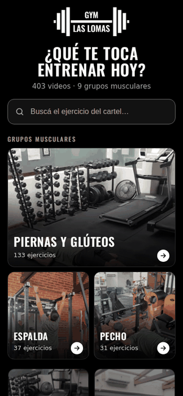
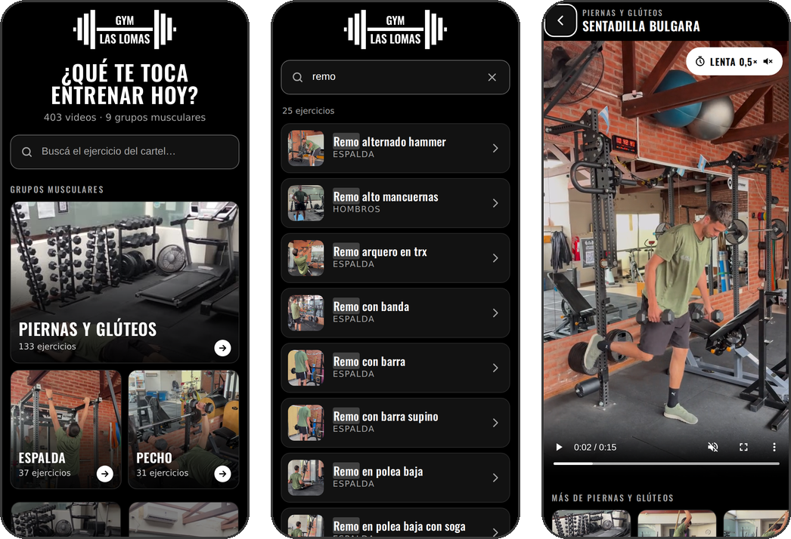
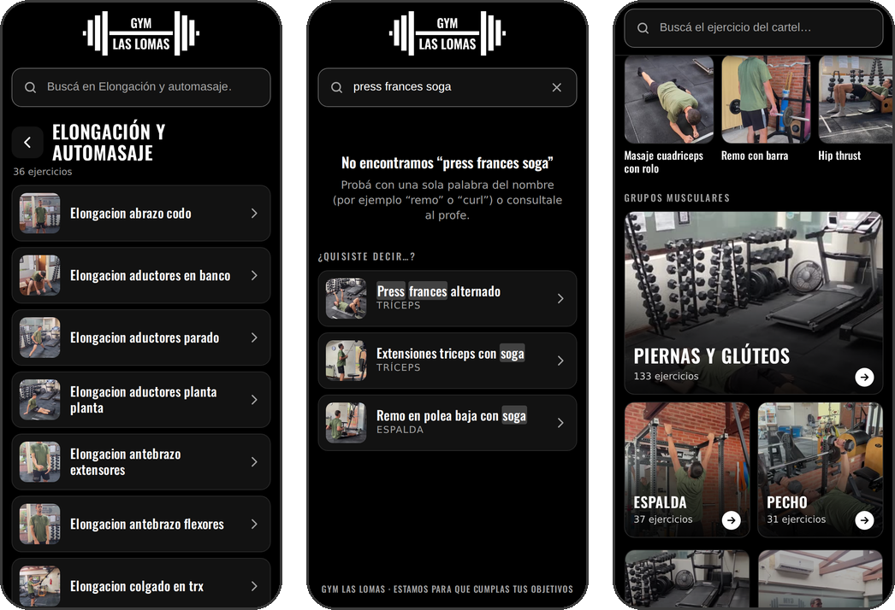
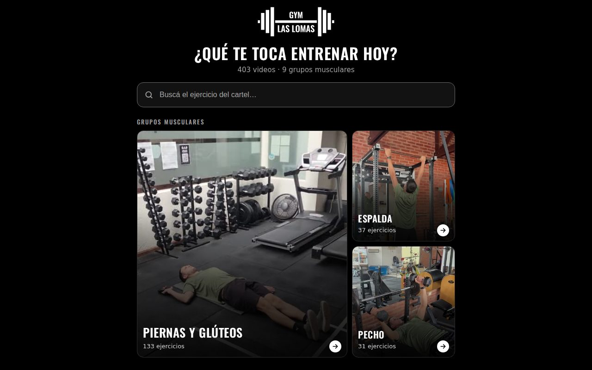
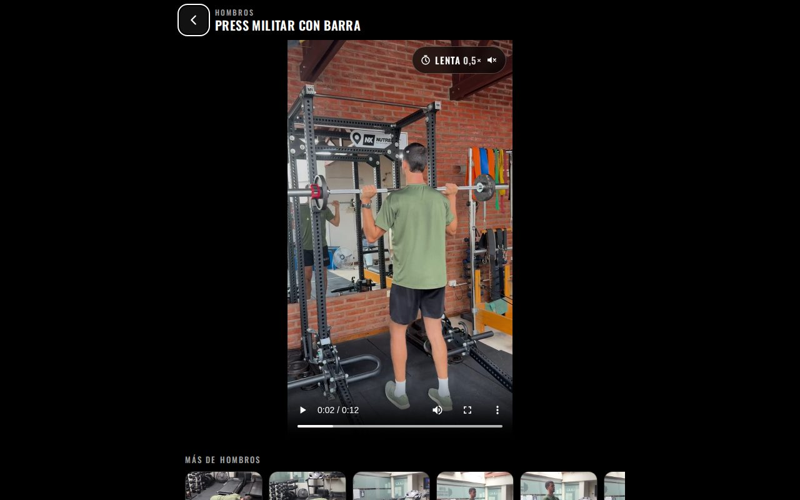
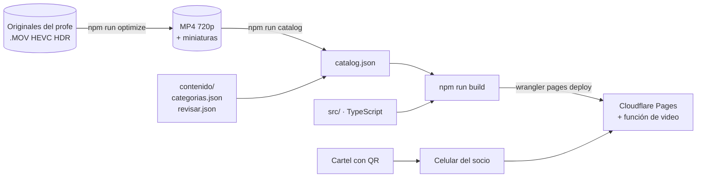

<p align="center">
  
</p>

<p align="center">
  <a href="https://gymlaslomas.pages.dev"></a>
</p>

<p align="center">
  
  
  <a href="../../actions/workflows/ci.yml"></a>
  
  
  
</p>

<p align="center">
  <a href="#-qué-es">Qué es</a> ·
  <a href="#-cómo-funciona">Cómo funciona</a> ·
  <a href="#-así-se-ve">Así se ve</a> ·
  <a href="#-qué-puede-hacer-cada-uno">Qué puede hacer cada uno</a> ·
  <a href="#-avance">Avance</a> ·
  <a href="#-para-desarrolladores">Para desarrolladores</a>
</p>

---

## 🏋️ Qué es

Es la **biblioteca de ejercicios en video de Gym Las Lomas**. Al lado de cada cartel de rutina hay un **QR**: el socio
lo escanea, escribe el nombre del ejercicio que lee en el cartel y mira cómo se hace, grabado por los profes del gym.

**403 videos en 9 grupos musculares**, desde cualquier celular, sin instalar nada y sin crear una cuenta.

<table>
  <tr>
    <th width="50%">😓 Antes</th>
    <th width="50%">😊 Con la web</th>
  </tr>
  <tr>
    <td>Si un socio no recordaba cómo se hacía un ejercicio, <b>tenía que esperar al profe</b>.</td>
    <td>Lo ve en el momento: <b>del escaneo al video en menos de 15 segundos</b>.</td>
  </tr>
  <tr>
    <td>El nombre del cartel no decía nada de la técnica.</td>
    <td>Cada ejercicio tiene <b>su video</b>, en loop y con <b>cámara lenta</b>.</td>
  </tr>
  <tr>
    <td>Buscar un video en redes daba versiones de otros gyms, con otra técnica.</td>
    <td>Solo contenido <b>propio y aprobado</b> por el gimnasio.</td>
  </tr>
  <tr>
    <td>Un error de tipeo con el celular en una mano era "no encontrado".</td>
    <td>La búsqueda <b>tolera tildes, errores y palabras en cualquier orden</b>, y si no hay resultados, sugiere.</td>
  </tr>
</table>

> [!IMPORTANT]
> **La regla de oro:** del QR al video en **un solo paso**. Sin login, sin registro, sin app y **sin datos del socio**.
> Cualquier funcionalidad nueva tiene que respetar eso ([RN-01, RN-02](docs/REGLAS-DE-NEGOCIO.md)).

---

## 🔄 Cómo funciona

<table>
  <tr>
    <td width="50%" valign="top">
      
    </td>
    <td width="50%" valign="top">
      
    </td>
  </tr>
</table>

- **No hay base de datos ni panel:** la carpeta de videos es la fuente de verdad. Lo que está en la carpeta es lo que se publica.
- **El nombre del archivo es el nombre del ejercicio**, tal como figura en el cartel, porque es lo que el socio va a escribir.
- **El QR no cambia nunca:** cada publicación nueva aparece sola en el mismo link, sin reimprimir carteles.

---

## 📸 Así se ve

<p align="center">
  
</p>

<p align="center">
  
</p>
<p align="center">
  
  <br><sub>📱 Pensada para el celular, dentro del gym y con una mano ocupada: botones grandes, letra legible y carga rápida con datos móviles.</sub>
</p>

<details>
<summary><b>🖥️ Ver en la compu</b></summary>

<br>

<p align="center"><br><b>Inicio</b>: el grupo destacado ocupa 2 × 2 y el resto se acomoda en 3 columnas</p>
<p align="center"><br><b>Video</b>: el marco se ajusta a la pantalla y la cámara lenta queda sobre la imagen</p>

</details>

---

## 🙋 Qué puede hacer cada uno

### 🙋 Socio
- ✅ Escanear el QR y empezar a buscar al instante, sin cuenta
- ✅ Buscar por nombre, aunque escriba con errores, sin tildes o con las palabras en otro orden (`bulg sent` → *Sentadilla búlgara*)
- ✅ Ver sugerencias ("¿Quisiste decir…?") cuando no hay resultados
- ✅ Recorrer los 9 grupos musculares, cada uno con su buscador
- ✅ Mirar el video en loop y pasarlo a **cámara lenta** (se silencia la música, para que no se escuche distorsionada)
- ✅ Volver a los **vistos recientemente**, que quedan solo en su celular y se pueden borrar con "Deshacer"
- ✅ Compartir el link de un ejercicio (por WhatsApp o lo que use el celular)

### 🏋️ Profe
- ✅ Grabar el video con el celular y nombrar el archivo como en el cartel
- ✅ Decidir en qué grupo muscular va cada ejercicio, editando [`contenido/categorias.json`](contenido/categorias.json) sin tocar los videos
- ✅ Dejar un video "en revisión" (por ejemplo, dos tomas del mismo ejercicio) sin frenar la publicación

### 🛠️ Administrador
- ✅ Convertir los videos del profe con un comando: MP4 liviano, miniatura y música del gym en lugar de voces
- ✅ Recibir avisos automáticos: nombres repetidos, copias, ejercicios sin categoría, videos muy pesados
- ✅ Publicar con un comando y volver a la versión anterior en un clic
- ✅ Generar el QR y el cartel A4 para imprimir

### 🏢 Gerencia
- ✅ Aprobar qué se publica: solo videos propios del gym
- ✅ Ver estadísticas de visitas **anónimas**, sin cookies (Cloudflare Web Analytics)

### 📜 Las reglas que siempre se cumplen

| | Regla |
|:-:|---|
| 🔓 | **Acceso libre**: del QR al video en un paso, sin login ni pantallas intermedias (RN-01). |
| 🔒 | **Sin datos personales**: no se pide, guarda ni envía nada del socio (RN-02). |
| 🗂️ | **La carpeta es la fuente de verdad**: lo que está en la carpeta se publica; lo que se borra, desaparece (RN-04). |
| 🏷️ | **Nombres únicos**: no puede haber dos ejercicios con el mismo nombre, aunque estén en grupos distintos (RN-06). |
| 🎬 | **Los originales no se tocan**: la conversión siempre escribe en otra carpeta (RN-09). |
| 📏 | **Formato estándar**: MP4 de hasta 720p y 25 MB, que empieza a reproducirse antes de terminar de bajar (RN-10). |
| 🔗 | **El QR no cambia**: la dirección está impresa en los carteles (RN-14). |
| ↩️ | **"Atrás" funciona como se espera**: vuelve a la lista, a la misma altura (RN-19). |
| ✅ | **Nada se publica sin verificar**: catálogo sin avisos, build aprobado y prueba en un celular (RN-22). |

> Todas las reglas, con su código para citarlas, están en [`docs/REGLAS-DE-NEGOCIO.md`](docs/REGLAS-DE-NEGOCIO.md).
> Las de búsqueda y catálogo tienen sus tests.

---

## 🚀 Avance

| Versión | | Estado |
|------|---|--------|
| 1.0 · Lanzamiento: buscador, video, QR y carteles | 🟩🟩🟩🟩🟩 | ✅ Publicada el 09/10/2026 |
| 1.0.x · 291 ejercicios, "/" como "o", rendimiento | 🟩🟩🟩🟩🟩 | ✅ Publicada |
| 1.1 · 403 ejercicios, Elongación y automasaje, inicio y animaciones nuevas | 🟩🟩🟩🟩🟩 | ✅ Publicada el 21/10/2026 |
| 1.2 · Sinónimos de búsqueda y estadísticas anónimas propias | ⬜⬜⬜⬜⬜ | 🔜 Próxima |
| 2 · Rutinas: un QR por tipo de rutina, que el profe actualiza solo | ⬜⬜⬜⬜⬜ | 🔜 [Planificada](docs/ROADMAP.md) |
| 3 · Panel para que el profe suba videos desde el celular | ⬜⬜⬜⬜⬜ | 💭 A futuro |

Detalle en [`docs/ROADMAP.md`](docs/ROADMAP.md) y cambio por cambio en [`CHANGELOG.md`](CHANGELOG.md).

---

## 🛠️ Para desarrolladores

<details>
<summary><b>⚡ Cómo correrlo en tu compu</b></summary>

<br>

**Necesitás:** Node.js 22 (`.nvmrc`) y Git. ffmpeg no hace falta: viene incluido como dependencia (`ffmpeg-static`).

```bash
# 1. Clonar el repo
git clone https://github.com/KevinKener/gym-las-lomas.git
cd gym-las-lomas

# 2. Instalar dependencias
npm install

# 3. Configurar la carpeta de videos
cp .env.example .env
# completar VIDEOS_DIR (y RAW_VIDEOS_DIR si vas a convertir videos)

# 4. Levantar el servidor de desarrollo
npm run dev
```

Abrí [http://localhost:5173](http://localhost:5173). En WSL, una carpeta de Windows como `D:\videos` se escribe `/mnt/d/videos`.

| Comando | Qué hace |
|---|---|
| `npm run dev` | Genera el catálogo y levanta el servidor (sirve los videos desde `VIDEOS_DIR`) |
| `npm run check` | Typecheck + tests. Correrlo antes de dar algo por terminado (también corre en CI) |
| `npm test` | Tests (`node:test`, sin dependencias extra) |
| `npm run optimize -- <origen> <destino>` | Convierte a MP4 720p (HDR → SDR) y genera miniaturas. Nunca toca los originales. Con `--music <audio>` reemplaza el sonido por la música del gym |
| `npm run catalog` | Regenera `public/catalog.json` y muestra los avisos de contenido |
| `npm run build` | Catálogo en modo estricto (falla con avisos) + typecheck + build en `dist/` |
| `npm run qr -- <url>` | Genera el QR y el cartel A4 en `qr/` |

</details>

<details>
<summary><b>🔑 Variables de entorno</b></summary>

<br>

| Variable | Descripción |
|----------|-------------|
| `VIDEOS_DIR` | Carpeta con los videos convertidos que se publican. Las subcarpetas cuentan como grupo muscular |
| `RAW_VIDEOS_DIR` | Carpeta con los originales del profe. Solo la usa `npm run optimize` |
| `VIDEO_BASE_URL` | Dónde se sirven los videos: `/videos/` (junto con la web) o la URL de un bucket |
| `COPY_VIDEOS` | `1` copia los videos a `dist/videos` en el build |
| `SITE_URL` | URL definitiva, para generar el QR |
| `CLOUDFLARE_API_TOKEN` · `CLOUDFLARE_ACCOUNT_ID` | Para publicar en Cloudflare Pages. Permiso "Account · Cloudflare Pages · Edit" |

> [!WARNING]
> `.env` **nunca** se sube al repo ni se pega en un chat. Si sumás una variable, agregala a `.env.example` (sin valor) y a esta tabla.

</details>

<details>
<summary><b>🎬 Agregar o cambiar ejercicios</b></summary>

<br>

1. Guardar el video original en `RAW_VIDEOS_DIR`. **El nombre del archivo es el que ve el socio** y tiene que coincidir con el cartel (RN-05).
2. `npm run optimize`: convierte solo lo nuevo. Si el video tiene voces en vez de música:
   `npm run optimize -- <origen> <destino> --music "<carpeta>/musica-gym.m4a"`.
3. Sumar el ejercicio a su grupo en [`contenido/categorias.json`](contenido/categorias.json) (RN-07).
4. `npm run catalog`: resolver todos los avisos (nombres repetidos, copias, formato, peso).
5. Publicar.

Si un video todavía no se puede resolver (por ejemplo, dos tomas del mismo ejercicio), se carga en
[`contenido/revisar.json`](contenido/revisar.json): se publica con un nombre prolijo y queda en la lista de pendientes.

Con Claude Code, todo esto es `/agregar-ejercicios`.

</details>

<details>
<summary><b>☁️ Publicar en Cloudflare Pages</b></summary>

<br>

```bash
npm run build
set -a && . ./.env && set +a       # credenciales de Cloudflare desde .env
npx wrangler pages deploy dist --project-name gymlaslomas --branch main --commit-hash "$(git rev-parse HEAD)"
```

- Solo se suben los archivos que cambiaron: sumar videos tarda segundos.
- Para volver atrás: Cloudflare → Workers & Pages → `gymlaslomas` → Deployments → *Rollback*.
- La dirección `gymlaslomas.pages.dev` está impresa en los QR: **no se cambia** (RN-14). Un dominio propio se puede sumar sin romperla.
- Con Claude Code: `/publicar` (lo arranca la persona, nunca el agente). Corre los controles, pide confirmación y verifica en vivo.

</details>

<details>
<summary><b>🧱 Stack y decisiones</b></summary>

<br>

| Capa | Tecnología |
|------|-----------|
| Interfaz | TypeScript estricto, **sin frameworks** (D-02): es un buscador, una lista y un reproductor |
| Build | [Vite](https://vite.dev/) |
| Búsqueda | Propia, unas 170 líneas con reglas explícitas y tests (D-03) |
| Videos | `ffmpeg-static`: MP4 H.264 720p, `faststart`, miniatura JPG |
| Hosting | Cloudflare Pages + una función que sirve los videos por partes (`Range`/206), sin la cual no se reproducen en iPhone (D-10) |
| Estadísticas | Cloudflare Web Analytics, anónimo y sin cookies (D-12) |



La identidad visual (blanco y negro, Oswald, el logo de la barra) está en [`docs/MARCA.md`](docs/MARCA.md), y el sistema de
diseño (tokens, componentes, animaciones y checklist de UI) en [`docs/DESIGN-SYSTEM.md`](docs/DESIGN-SYSTEM.md).
Cada decisión técnica, con su motivo, está en [`docs/ARQUITECTURA.md`](docs/ARQUITECTURA.md).

</details>

<details>
<summary><b>📂 Estructura del código</b></summary>

<br>

```
src/
├── main.ts              # Interfaz: inicio, listas, reproductor, transiciones, historial
├── search.ts            # Búsqueda tolerante, sugerencias y resaltado (lógica pura, con tests)
├── router.ts            # Rutas por hash (puro)
├── range.ts             # Pedidos parciales de video (puro)
├── styles.css           # Tokens del design system y estilos, mobile first
└── assets/logo.svg      # Logo vectorial
functions/videos/        # Función de Cloudflare Pages: video por partes para iPhone
scripts/                 # Catálogo (catalog-lib.mjs es puro), conversión de videos y QR
contenido/               # Grupos musculares y pendientes de revisión: los edita el gimnasio
tests/                   # Búsqueda, catálogo, rutas y rangos
docs/                    # Reglas, flujos, arquitectura, marca, design system, roadmap y material del README
.claude/                 # Skills, agentes y hook de Claude Code
```

La lógica de negocio vive separada del DOM y del disco, para poder testearla.

</details>

<details>
<summary><b>🗺️ Rutas</b></summary>

<br>

Todo va por hash para funcionar en cualquier hosting estático.

| URL | Descripción |
|-----|-------------|
| `/` · `#/` | Inicio: titular, buscador, vistos recientemente y grupos musculares |
| `#/c/<grupo>` | Lista de un grupo muscular, con su propio buscador (por ejemplo `#/c/espalda`) |
| `#/todos` | Todos los ejercicios |
| `#/e/<ejercicio>` | Video de un ejercicio, que se abre encima de la lista (RN-15) |
| `/?q=<texto>` | Abre la web con la búsqueda hecha (RN-16) |
| `/?cat=<Grupo>` | Abre un grupo muscular: sirve para QR por zona del gym (RN-16) |

</details>

<details>
<summary><b>🧪 Calidad</b></summary>

<br>

- **Tests:** 57, con `node:test`. Cada regla relevante tiene el suyo: búsqueda (RN-11 a RN-13), catálogo (RN-05 a RN-10), rutas (RN-15, RN-16, RN-19) y pedidos parciales (D-10).
- **CI:** GitHub Actions corre typecheck y tests en cada push y pull request.
- **Peso:** unos 15 KB en gzip sin la fuente (límite: 50 KB, RN-18). Las primeras fotos nunca arrancan transparentes, para no castigar la carga (LCP).
- **Accesibilidad:** zonas táctiles de 44 px, contraste AA, avisos para lectores de pantalla y todas las animaciones apagadas con "reducir movimiento".
- **Reglas citables:** cada comportamiento se apoya en una regla `RN-XX` o una decisión `D-XX`, que se citan en el código y en los commits.

</details>

<details>
<summary><b>🤖 Trabajar con Claude Code</b></summary>

<br>

[`CLAUDE.md`](CLAUDE.md) define las reglas del proyecto para [Claude Code](https://claude.com/claude-code).

| | Nombre | Para qué |
|---|---|---|
| Skill | `/agregar-ejercicios` | Revisa nombres, convierte, asigna grupo y valida videos nuevos |
| Skill | `/publicar` | Controles, deploy y verificación. Solo lo arranca la persona |
| Skill | `/generar-cartel` | QR y cartel A4, con checklist de impresión |
| Skill | `/nueva-funcionalidad` | Diseña una funcionalidad respetando reglas, arquitectura y roadmap |
| Agente | `revisor-reglas` | Revisa cambios contra las reglas de negocio |
| Agente | `revisor-ux-movil` | Revisa interfaz y textos pensando en el celular dentro del gym |
| Agente | `curador-videos` | Audita nombres, duplicados, formatos y pesos del contenido |
| Hook | `check.mjs` | Corre typecheck y tests después de cada edición de código |

</details>

<details>
<summary><b>📚 Documentación</b></summary>

<br>

| Documento | Para qué |
|-----------|----------|
| [`docs/REGLAS-DE-NEGOCIO.md`](docs/REGLAS-DE-NEGOCIO.md) | Lo que el producto tiene que cumplir: actores y reglas `RN-01`… |
| [`docs/FLUJOS.md`](docs/FLUJOS.md) | Socio, carga de videos, publicación e instalación en el gym |
| [`docs/ARQUITECTURA.md`](docs/ARQUITECTURA.md) | Piezas, contrato de `catalog.json`, rutas y decisiones `D-01`… |
| [`docs/DESIGN-SYSTEM.md`](docs/DESIGN-SYSTEM.md) | Tokens, componentes, animaciones y checklist de interfaz |
| [`docs/MARCA.md`](docs/MARCA.md) | Logo, colores y tipografía de Gym Las Lomas |
| [`docs/ROADMAP.md`](docs/ROADMAP.md) | Próximas versiones |
| [`CHANGELOG.md`](CHANGELOG.md) | Historial de versiones |

Las imágenes de este README se generan con `python3 docs/readme/diagramas.py` (banner y diagramas) y con capturas de la web publicada.

</details>

---

## 👥 Hecho por

<table align="center">
  <tr>
    <td align="center">
      <a href="https://github.com/KevinKener"><br><b>Kevin Kener</b></a><br><sub>@KevinKener</sub>
    </td>
  </tr>
</table>

<p align="center">
  Desarrollado para <b>Gym Las Lomas</b> · <i>Estamos para que cumplas tus objetivos</i> 💪
</p>

<p align="center">
  <sub>El código se publica para consulta: todos los derechos reservados (ver <a href="LICENSE">LICENSE</a>).
  El logo, la marca y los videos pertenecen a Gym Las Lomas y se muestran con su autorización.</sub>
</p>
